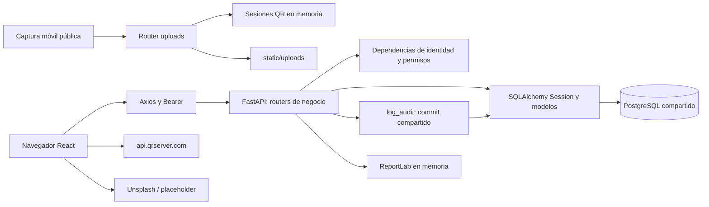

# Arquitectura reconstruida

## Componentes y capas

La arquitectura observada combina SPA y API de un único proceso lógico, con PostgreSQL como persistencia central y disco local para archivos. Compose los separa en tres contenedores; esto no convierte los módulos HTTP en microservicios. Clasificación **inferida** de `docker-compose.yml:2-60`, `backend/app/main.py:26-54` y `backend/app/db/session.py:5-24`.

Fuente editable: [componentes](diagramas/componentes.mmd). Evidencias adicionales: `backend/app/api/routes/uploads.py:11-118`, `backend/app/api/routes/invoices.py:348-1494`, `frontend/src/components/ImageUploadControl.jsx:55-106`, `frontend/src/pages/Login.jsx:33-53`.

El [diagrama de dependencias internas](diagramas/dependencias.mmd) distingue composición activa y auxiliares sin callers. Patrones confirmados: inyección mediante Depends; ORM declarativo y sesión compartida; DTOs Pydantic; contexto React para identidad; interceptores Axios. No se identifica una capa Repository, una máquina de estados formal ni coordinación mediante eventos: la orquestación está en los handlers. Evidencias: `backend/app/api/deps.py:12-74`, `backend/app/db/session.py:14-24`, `backend/app/api/routes/services.py:60-272`, `frontend/src/context/AuthContext.jsx:11-89`, `frontend/src/services/api.js:7-25`.

| Capa/componente | Responsabilidad | Dependencias |
|---|---|---|
| App, Layout, Sidebar | Enrutamiento, navegación y filtros visuales | AuthContext, permissions, páginas |
| Páginas React | Formularios, carga HTTP, listas, métricas locales, mensajes | Axios, estado/hooks, componentes locales |
| Axios | URL base, token local, redirección al recibir 401 | localStorage y window |
| Dependencias FastAPI | Token, usuario actual, empresa activa, rol o permiso | security, config, sesión y User |
| Routers | Contratos, consultas, reglas y escritura | modelos, schemas, auditoría |
| ORM | Columnas, relaciones, índices y unidad de trabajo | SQLAlchemy y psycopg2 |
| Servicios auxiliares | Guardar auditoría/notificación; rutina de inventario no utilizada | La misma sesión que el router |
| ReportLab | Construir PDF A4 a partir del comprobante | BytesIO, detalles y servicio actual |

Referencias por módulo en [trazabilidad](trazabilidad.md); firma exacta de dependencias HTTP en [API](06-apis-integraciones.md).

## Autenticación y autorización

`login` recibe JSON `{email,password}`, busca email global, verifica bcrypt, usuario activo y empresa activa; genera JWT con `sub`, `exp`, `role`, `empresa_id`. El token usa algoritmo configurable, HS256 por defecto, y duración predeterminada de 480 minutos. Cada petición protegida decodifica el token y vuelve a consultar User: las decisiones usan el rol y permisos actuales de base de datos, no los claims de rol/empresa como autoridad. Fuentes: `backend/app/api/routes/auth.py:13-56`, `backend/app/core/security.py:7-33`, `backend/app/api/deps.py:12-74`.

`require_superadmin` protege empresas; `require_admin` permite ADMIN y SUPERADMIN para usuarios/auditoría. `check_permission` concede acceso directo a esos dos roles; los demás necesitan `permisos[modulo][accion] is True`. Dashboard y envío de notificaciones solo requieren identidad; uploads no usa dependencias de identidad. El diccionario empresarial `modulos_permitidos` se persiste y devuelve, pero no interviene en esos controles. Fuentes: `backend/app/api/deps.py:41-74`, `backend/app/api/routes/dashboard.py:16-20`, `backend/app/api/routes/notifications.py:12-17`, `backend/app/api/routes/uploads.py:24-118`, `backend/app/api/routes/companies.py:126-128`.

La SPA guarda tanto token como respuesta de login en localStorage. No revalida `/auth/me` al arrancar; el logout limpia el navegador y no revoca JWT. El guard de App combina listas de roles con permiso `ver`; botones internos suelen comprobar roles fijos. Los permisos de UI pueden quedar desactualizados hasta un nuevo login, y difieren de los del servidor. Fuentes: `frontend/src/context/AuthContext.jsx:13-73`, `frontend/src/App.jsx:48-81`, `frontend/src/utils/permissions.js:50-72`, `frontend/src/pages/Clients.jsx:58-61`.

## Multiempresa

Una base y esquema compartidos; numerosas tablas incluyen `empresa_id`. Los routers normalmente filtran por la empresa del usuario, excepto SUPERADMIN. Las creaciones de clientes, equipos, servicios, productos, licencias y comprobantes usan `current_user.empresa_id or 1`. Los pagos toman la empresa del servicio. No hay FK compuestas que obliguen a que un cliente, servicio y producto pertenezcan a la misma empresa. Estas observaciones no garantizan aislamiento: ver H01–H04. Fuentes: modelos de `client`, `equipment`, `service`, `product`, `license`, `invoice`, `payment`; rutas homónimas de creación.

## Transacciones, errores y concurrencia

`get_db` cierra la sesión al terminar; los routers deciden dónde confirmar. La función `log_audit` ejecuta `db.commit()` sobre la sesión recibida. Por tanto, puede confirmar también stock, detalles y comprobantes todavía pendientes. En CRUD simple la operación se confirma antes de auditar; un fallo posterior no deshace la primera confirmación. La creación de empresa confirma empresa y administrador separadamente. Fuentes: `backend/app/db/session.py:19-24`, `backend/app/services/audit_service.py:5-23`, `backend/app/api/routes/companies.py:74-98`, `backend/app/api/routes/services.py:224-258`, `backend/app/api/routes/invoices.py:244-288`.

El consumo bloquea la fila del producto con `with_for_update`; registro de pagos y selección del siguiente correlativo no muestran bloqueo equivalente ni reintento ante conflictos de unicidad. **Inferido:** hay riesgo de pagos simultáneos superiores al saldo y de colisión de correlativos. No se realizaron pruebas concurrentes. Fuentes: `backend/app/api/routes/services.py:207-257`, `backend/app/api/routes/payments.py:128-183`, `backend/app/api/routes/invoices.py:56-74`.

Errores de negocio usan HTTPException 400/401/403/404; los schemas validan tipos, enums y algunos límites antes de ejecutar. No hay manejador global de IntegrityError ni rollback explícito en los routers revisados. Errores de disco en uploads se convierten en 500 con texto de excepción. En frontend se mezclan mensajes inline, alert y console.error; no hay un tratamiento uniforme de errores de validación. Evidencias: routers completos, `backend/app/main.py:1-54`, `frontend/src/services/api.js:15-24`, `frontend/src/pages/Licenses.jsx:64-66`.

## Sincronía, estados y procesos externos

Las rutas de negocio usan funciones síncronas y SQLAlchemy síncrono. Dos handlers de archivo son `async` para leer el multipart, pero escriben con `open/write` síncrono. El «tiempo real» móvil consiste en polling cada 1500 ms y un diccionario de proceso; no se encontró WebSocket, cola ni trabajador de notificaciones. Los vencimientos se calculan durante la lectura, sin tareas programadas. Fuentes: `backend/app/api/routes/uploads.py:16-118`, `frontend/src/components/ImageUploadControl.jsx:78-103`, `backend/app/api/routes/licenses.py:16-31`, `backend/app/services/notification_service.py:5-26`.
