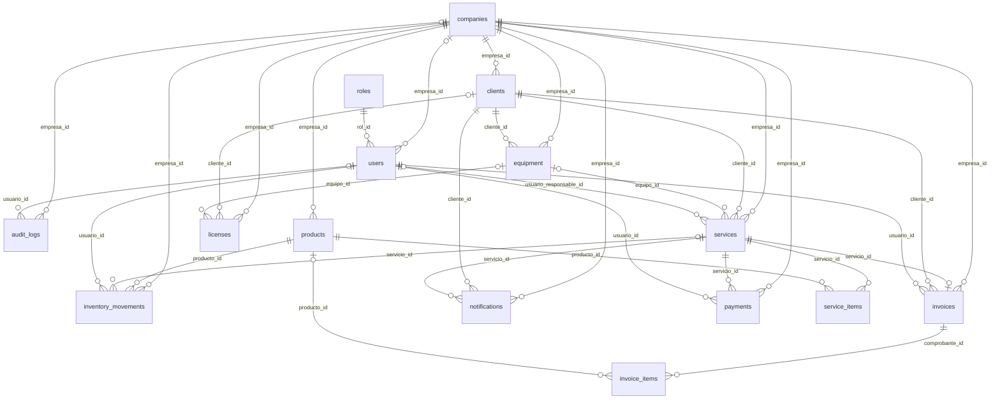

# Modelo y diccionario de datos

El modelo reconstruido corresponde a las declaraciones ORM actuales. **No es una introspección de la base instalada.** La cadena Alembic no reproduce íntegramente este modelo; véase [despliegue](09-configuracion-despliegue.md).

## Convenciones

Las 15 entidades declaran PK `id`. `mapped_column` muestra literalmente tipos SQL, FK, nulabilidad explícita, defaults de aplicación e índices. Cuando no hay `nullable`, la anotación `Mapped[Optional[...]]` distingue el campo opcional del obligatorio; no se atribuye un `server_default` si solo existe `default`. Fechas usan `datetime.now(timezone.utc)` en los modelos, excepto vigencias tipo Date. Importes son Numeric(10,2); varios contratos los exponen como float y los de comprobantes como Decimal. Fuente: declaraciones de cada campo enlazadas abajo.

## Entidades y campos

### `audit_logs` — Audit

[backend/app/models/audit.py:7](../../backend/app/models/audit.py)

| Campo | Anotación | Declaración de almacenamiento | Evidencia |
|---|---|---|---|
| `id` | `Mapped[int]` | `mapped_column(Integer, primary_key=True, index=True)` | [backend/app/models/audit.py:13](../../backend/app/models/audit.py) |
| `empresa_id` | `Mapped[Optional[int]]` | `mapped_column(Integer, ForeignKey('companies.id', ondelete='CASCADE'), nullable=True, index=True)` | [backend/app/models/audit.py:14](../../backend/app/models/audit.py) |
| `usuario_id` | `Mapped[Optional[int]]` | `mapped_column(ForeignKey('users.id', ondelete='SET NULL'), nullable=True, index=True)` | [backend/app/models/audit.py:15](../../backend/app/models/audit.py) |
| `accion` | `Mapped[str]` | `mapped_column(String(50), nullable=False, index=True)` | [backend/app/models/audit.py:16](../../backend/app/models/audit.py) |
| `entidad` | `Mapped[str]` | `mapped_column(String(50), nullable=False, index=True)` | [backend/app/models/audit.py:17](../../backend/app/models/audit.py) |
| `entidad_id` | `Mapped[Optional[int]]` | `mapped_column(Integer, nullable=True)` | [backend/app/models/audit.py:18](../../backend/app/models/audit.py) |
| `descripcion` | `Mapped[str]` | `mapped_column(String(500), nullable=False)` | [backend/app/models/audit.py:19](../../backend/app/models/audit.py) |
| `fecha` | `Mapped[datetime]` | `mapped_column(DateTime(timezone=True), default=lambda: datetime.now(timezone.utc))` | [backend/app/models/audit.py:20](../../backend/app/models/audit.py) |

Índices compuestos explícitos: `(Index('ix_audit_logs_empresa_id_id', 'empresa_id', 'id'),)`.

Relaciones ORM: `usuario = relationship('User', back_populates='auditorias')`.

### `clients` — Client

[backend/app/models/client.py:7](../../backend/app/models/client.py)

| Campo | Anotación | Declaración de almacenamiento | Evidencia |
|---|---|---|---|
| `id` | `Mapped[int]` | `mapped_column(Integer, primary_key=True, index=True)` | [backend/app/models/client.py:14](../../backend/app/models/client.py) |
| `empresa_id` | `Mapped[int]` | `mapped_column(Integer, ForeignKey('companies.id', ondelete='CASCADE'), nullable=False, default=1, index=True)` | [backend/app/models/client.py:15](../../backend/app/models/client.py) |
| `nombres` | `Mapped[str]` | `mapped_column(String(100), nullable=False)` | [backend/app/models/client.py:16](../../backend/app/models/client.py) |
| `apellidos` | `Mapped[str]` | `mapped_column(String(100), nullable=False)` | [backend/app/models/client.py:17](../../backend/app/models/client.py) |
| `documento` | `Mapped[str]` | `mapped_column(String(20), nullable=False, index=True)` | [backend/app/models/client.py:18](../../backend/app/models/client.py) |
| `telefono` | `Mapped[str]` | `mapped_column(String(20), nullable=False)` | [backend/app/models/client.py:19](../../backend/app/models/client.py) |
| `email` | `Mapped[Optional[str]]` | `mapped_column(String(150), nullable=True)` | [backend/app/models/client.py:20](../../backend/app/models/client.py) |
| `direccion` | `Mapped[Optional[str]]` | `mapped_column(String(255), nullable=True)` | [backend/app/models/client.py:21](../../backend/app/models/client.py) |
| `activo` | `Mapped[bool]` | `mapped_column(Boolean, default=True, nullable=False)` | [backend/app/models/client.py:22](../../backend/app/models/client.py) |
| `created_at` | `Mapped[datetime]` | `mapped_column(DateTime(timezone=True), default=lambda: datetime.now(timezone.utc))` | [backend/app/models/client.py:23](../../backend/app/models/client.py) |

Índices compuestos explícitos: `(Index('ix_clients_empresa_documento', 'empresa_id', 'documento', unique=True), Index('ix_clients_empresa_id_id', 'empresa_id', 'id'))`.

Relaciones ORM: `equipos = relationship('Equipment', back_populates='cliente')`; `servicios = relationship('Service', back_populates='cliente')`; `notificaciones = relationship('Notification', back_populates='cliente')`.

### `companies` — Company

[backend/app/models/company.py:7](../../backend/app/models/company.py)

| Campo | Anotación | Declaración de almacenamiento | Evidencia |
|---|---|---|---|
| `id` | `Mapped[int]` | `mapped_column(Integer, primary_key=True, index=True)` | [backend/app/models/company.py:10](../../backend/app/models/company.py) |
| `nombre` | `Mapped[str]` | `mapped_column(String(150), nullable=False, index=True)` | [backend/app/models/company.py:11](../../backend/app/models/company.py) |
| `ruc_documento` | `Mapped[Optional[str]]` | `mapped_column(String(20), nullable=True, index=True)` | [backend/app/models/company.py:12](../../backend/app/models/company.py) |
| `email_contacto` | `Mapped[Optional[str]]` | `mapped_column(String(150), nullable=True)` | [backend/app/models/company.py:13](../../backend/app/models/company.py) |
| `telefono` | `Mapped[Optional[str]]` | `mapped_column(String(50), nullable=True)` | [backend/app/models/company.py:14](../../backend/app/models/company.py) |
| `direccion` | `Mapped[Optional[str]]` | `mapped_column(String(255), nullable=True)` | [backend/app/models/company.py:15](../../backend/app/models/company.py) |
| `activo` | `Mapped[bool]` | `mapped_column(Boolean, default=True, nullable=False, index=True)` | [backend/app/models/company.py:16](../../backend/app/models/company.py) |
| `limite_usuarios` | `Mapped[int]` | `mapped_column(Integer, default=10, nullable=False)` | [backend/app/models/company.py:17](../../backend/app/models/company.py) |
| `modulos_permitidos` | `Mapped[Optional[dict]]` | `mapped_column(JSON, nullable=True)` | [backend/app/models/company.py:18](../../backend/app/models/company.py) |
| `created_at` | `Mapped[datetime]` | `mapped_column(DateTime(timezone=True), default=lambda: datetime.now(timezone.utc), nullable=False)` | [backend/app/models/company.py:19](../../backend/app/models/company.py) |
| `updated_at` | `Mapped[datetime]` | `mapped_column(DateTime(timezone=True), default=lambda: datetime.now(timezone.utc), onupdate=lambda: datetime.now(timezone.utc), nullable=False)` | [backend/app/models/company.py:20](../../backend/app/models/company.py) |

Relaciones ORM: `users = relationship('User', back_populates='empresa')`.

### `equipment` — Equipment

[backend/app/models/equipment.py:7](../../backend/app/models/equipment.py)

| Campo | Anotación | Declaración de almacenamiento | Evidencia |
|---|---|---|---|
| `id` | `Mapped[int]` | `mapped_column(Integer, primary_key=True, index=True)` | [backend/app/models/equipment.py:13](../../backend/app/models/equipment.py) |
| `empresa_id` | `Mapped[int]` | `mapped_column(Integer, ForeignKey('companies.id', ondelete='CASCADE'), nullable=False, default=1, index=True)` | [backend/app/models/equipment.py:14](../../backend/app/models/equipment.py) |
| `cliente_id` | `Mapped[int]` | `mapped_column(ForeignKey('clients.id', ondelete='CASCADE'), nullable=False, index=True)` | [backend/app/models/equipment.py:15](../../backend/app/models/equipment.py) |
| `tipo` | `Mapped[str]` | `mapped_column(String(50), nullable=False)` | [backend/app/models/equipment.py:16](../../backend/app/models/equipment.py) |
| `marca` | `Mapped[str]` | `mapped_column(String(50), nullable=False)` | [backend/app/models/equipment.py:17](../../backend/app/models/equipment.py) |
| `modelo` | `Mapped[str]` | `mapped_column(String(50), nullable=False)` | [backend/app/models/equipment.py:18](../../backend/app/models/equipment.py) |
| `numero_serie` | `Mapped[Optional[str]]` | `mapped_column(String(100), nullable=True, index=True)` | [backend/app/models/equipment.py:19](../../backend/app/models/equipment.py) |
| `descripcion` | `Mapped[Optional[str]]` | `mapped_column(String(255), nullable=True)` | [backend/app/models/equipment.py:20](../../backend/app/models/equipment.py) |
| `imagen_url` | `Mapped[Optional[str]]` | `mapped_column(String(500), nullable=True)` | [backend/app/models/equipment.py:21](../../backend/app/models/equipment.py) |
| `created_at` | `Mapped[datetime]` | `mapped_column(DateTime(timezone=True), default=lambda: datetime.now(timezone.utc))` | [backend/app/models/equipment.py:22](../../backend/app/models/equipment.py) |

Índices compuestos explícitos: `(Index('ix_equipment_empresa_id_id', 'empresa_id', 'id'),)`.

Relaciones ORM: `cliente = relationship('Client', back_populates='equipos')`; `servicios = relationship('Service', back_populates='equipo')`.

### `inventory_movements` — InventoryMovement

[backend/app/models/inventory.py:12](../../backend/app/models/inventory.py)

| Campo | Anotación | Declaración de almacenamiento | Evidencia |
|---|---|---|---|
| `id` | `Mapped[int]` | `mapped_column(Integer, primary_key=True, index=True)` | [backend/app/models/inventory.py:18](../../backend/app/models/inventory.py) |
| `empresa_id` | `Mapped[int]` | `mapped_column(Integer, ForeignKey('companies.id', ondelete='CASCADE'), nullable=False, default=1, index=True)` | [backend/app/models/inventory.py:19](../../backend/app/models/inventory.py) |
| `producto_id` | `Mapped[int]` | `mapped_column(ForeignKey('products.id', ondelete='CASCADE'), nullable=False, index=True)` | [backend/app/models/inventory.py:20](../../backend/app/models/inventory.py) |
| `tipo` | `Mapped[MovementType]` | `mapped_column(SQLEnum(MovementType), nullable=False)` | [backend/app/models/inventory.py:21](../../backend/app/models/inventory.py) |
| `cantidad` | `Mapped[int]` | `mapped_column(Integer, nullable=False)` | [backend/app/models/inventory.py:22](../../backend/app/models/inventory.py) |
| `servicio_id` | `Mapped[Optional[int]]` | `mapped_column(ForeignKey('services.id', ondelete='SET NULL'), nullable=True, index=True)` | [backend/app/models/inventory.py:23](../../backend/app/models/inventory.py) |
| `usuario_id` | `Mapped[int]` | `mapped_column(ForeignKey('users.id'), nullable=False)` | [backend/app/models/inventory.py:24](../../backend/app/models/inventory.py) |
| `fecha` | `Mapped[datetime]` | `mapped_column(DateTime(timezone=True), default=lambda: datetime.now(timezone.utc))` | [backend/app/models/inventory.py:25](../../backend/app/models/inventory.py) |
| `observacion` | `Mapped[Optional[str]]` | `mapped_column(String(255), nullable=True)` | [backend/app/models/inventory.py:26](../../backend/app/models/inventory.py) |

Índices compuestos explícitos: `(Index('ix_inventory_movements_empresa_id_id', 'empresa_id', 'id'),)`.

Relaciones ORM: `producto = relationship('Product', back_populates='movimientos')`; `servicio = relationship('Service', back_populates='movimientos_inventario')`.

### `invoices` — Invoice

[backend/app/models/invoice.py:27](../../backend/app/models/invoice.py)

| Campo | Anotación | Declaración de almacenamiento | Evidencia |
|---|---|---|---|
| `id` | `Mapped[int]` | `mapped_column(Integer, primary_key=True, index=True)` | [backend/app/models/invoice.py:34](../../backend/app/models/invoice.py) |
| `empresa_id` | `Mapped[int]` | `mapped_column(Integer, ForeignKey('companies.id', ondelete='CASCADE'), nullable=False, default=1, index=True)` | [backend/app/models/invoice.py:35](../../backend/app/models/invoice.py) |
| `servicio_id` | `Mapped[int]` | `mapped_column(ForeignKey('services.id'), nullable=False, unique=True, index=True)` | [backend/app/models/invoice.py:36](../../backend/app/models/invoice.py) |
| `cliente_id` | `Mapped[int]` | `mapped_column(ForeignKey('clients.id'), nullable=False, index=True)` | [backend/app/models/invoice.py:37](../../backend/app/models/invoice.py) |
| `usuario_id` | `Mapped[int]` | `mapped_column(ForeignKey('users.id'), nullable=False, index=True)` | [backend/app/models/invoice.py:38](../../backend/app/models/invoice.py) |
| `tipo_comprobante` | `Mapped[InvoiceType]` | `mapped_column(SQLEnum(InvoiceType), nullable=False, index=True)` | [backend/app/models/invoice.py:39](../../backend/app/models/invoice.py) |
| `serie` | `Mapped[str]` | `mapped_column(String(10), nullable=False)` | [backend/app/models/invoice.py:40](../../backend/app/models/invoice.py) |
| `numero` | `Mapped[int]` | `mapped_column(Integer, nullable=False)` | [backend/app/models/invoice.py:41](../../backend/app/models/invoice.py) |
| `fecha_emision` | `Mapped[datetime]` | `mapped_column(DateTime(timezone=True), default=lambda: datetime.now(timezone.utc), nullable=False, index=True)` | [backend/app/models/invoice.py:42](../../backend/app/models/invoice.py) |
| `cliente_nombre` | `Mapped[str]` | `mapped_column(String(200), nullable=False)` | [backend/app/models/invoice.py:43](../../backend/app/models/invoice.py) |
| `cliente_documento` | `Mapped[str]` | `mapped_column(String(20), nullable=False)` | [backend/app/models/invoice.py:44](../../backend/app/models/invoice.py) |
| `cliente_direccion` | `Mapped[Optional[str]]` | `mapped_column(String(255), nullable=True)` | [backend/app/models/invoice.py:45](../../backend/app/models/invoice.py) |
| `subtotal` | `Mapped[Decimal]` | `mapped_column(Numeric(10, 2), nullable=False)` | [backend/app/models/invoice.py:46](../../backend/app/models/invoice.py) |
| `total` | `Mapped[Decimal]` | `mapped_column(Numeric(10, 2), nullable=False)` | [backend/app/models/invoice.py:47](../../backend/app/models/invoice.py) |
| `estado` | `Mapped[InvoiceStatus]` | `mapped_column(SQLEnum(InvoiceStatus), nullable=False, default=InvoiceStatus.EMITIDO, index=True)` | [backend/app/models/invoice.py:48](../../backend/app/models/invoice.py) |
| `observaciones` | `Mapped[Optional[str]]` | `mapped_column(Text, nullable=True)` | [backend/app/models/invoice.py:49](../../backend/app/models/invoice.py) |
| `created_at` | `Mapped[datetime]` | `mapped_column(DateTime(timezone=True), default=lambda: datetime.now(timezone.utc), nullable=False)` | [backend/app/models/invoice.py:50](../../backend/app/models/invoice.py) |

Índices compuestos explícitos: `(Index('ix_invoices_empresa_tipo_serie_numero', 'empresa_id', 'tipo_comprobante', 'serie', 'numero', unique=True), Index('ix_invoices_empresa_id_id', 'empresa_id', 'id'))`.

Relaciones ORM: `servicio = relationship('Service', back_populates='comprobante')`; `cliente = relationship('Client')`; `usuario = relationship('User')`; `detalles = relationship('InvoiceItem', back_populates='comprobante', cascade='all, delete-orphan')`.

### `invoice_items` — InvoiceItem

[backend/app/models/invoice.py:57](../../backend/app/models/invoice.py)

| Campo | Anotación | Declaración de almacenamiento | Evidencia |
|---|---|---|---|
| `id` | `Mapped[int]` | `mapped_column(Integer, primary_key=True, index=True)` | [backend/app/models/invoice.py:60](../../backend/app/models/invoice.py) |
| `comprobante_id` | `Mapped[int]` | `mapped_column(ForeignKey('invoices.id', ondelete='CASCADE'), nullable=False, index=True)` | [backend/app/models/invoice.py:61](../../backend/app/models/invoice.py) |
| `producto_id` | `Mapped[Optional[int]]` | `mapped_column(ForeignKey('products.id'), nullable=True, index=True)` | [backend/app/models/invoice.py:62](../../backend/app/models/invoice.py) |
| `concepto` | `Mapped[str]` | `mapped_column(String(255), nullable=False)` | [backend/app/models/invoice.py:63](../../backend/app/models/invoice.py) |
| `cantidad` | `Mapped[Decimal]` | `mapped_column(Numeric(10, 2), nullable=False)` | [backend/app/models/invoice.py:64](../../backend/app/models/invoice.py) |
| `precio_unitario` | `Mapped[Decimal]` | `mapped_column(Numeric(10, 2), nullable=False)` | [backend/app/models/invoice.py:65](../../backend/app/models/invoice.py) |
| `subtotal` | `Mapped[Decimal]` | `mapped_column(Numeric(10, 2), nullable=False)` | [backend/app/models/invoice.py:66](../../backend/app/models/invoice.py) |

Relaciones ORM: `comprobante = relationship('Invoice', back_populates='detalles')`; `producto = relationship('Product')`.

### `licenses` — License

[backend/app/models/license.py:7](../../backend/app/models/license.py)

| Campo | Anotación | Declaración de almacenamiento | Evidencia |
|---|---|---|---|
| `id` | `Mapped[int]` | `mapped_column(Integer, primary_key=True, index=True)` | [backend/app/models/license.py:13](../../backend/app/models/license.py) |
| `empresa_id` | `Mapped[int]` | `mapped_column(Integer, ForeignKey('companies.id', ondelete='CASCADE'), nullable=False, index=True)` | [backend/app/models/license.py:14](../../backend/app/models/license.py) |
| `cliente_id` | `Mapped[Optional[int]]` | `mapped_column(ForeignKey('clients.id', ondelete='SET NULL'), nullable=True, index=True)` | [backend/app/models/license.py:15](../../backend/app/models/license.py) |
| `equipo_id` | `Mapped[Optional[int]]` | `mapped_column(ForeignKey('equipment.id', ondelete='SET NULL'), nullable=True, index=True)` | [backend/app/models/license.py:16](../../backend/app/models/license.py) |
| `categoria` | `Mapped[str]` | `mapped_column(String(50), nullable=False, default='ANTIVIRUS')` | [backend/app/models/license.py:18](../../backend/app/models/license.py) |
| `nombre_producto` | `Mapped[str]` | `mapped_column(String(150), nullable=False)` | [backend/app/models/license.py:19](../../backend/app/models/license.py) |
| `clave_licencia` | `Mapped[str]` | `mapped_column(String(255), nullable=False)` | [backend/app/models/license.py:20](../../backend/app/models/license.py) |
| `cantidad_dispositivos` | `Mapped[int]` | `mapped_column(Integer, nullable=False, default=1)` | [backend/app/models/license.py:21](../../backend/app/models/license.py) |
| `es_permanente` | `Mapped[bool]` | `mapped_column(Boolean, nullable=False, default=False)` | [backend/app/models/license.py:23](../../backend/app/models/license.py) |
| `fecha_inicio` | `Mapped[Optional[date]]` | `mapped_column(Date, nullable=True)` | [backend/app/models/license.py:24](../../backend/app/models/license.py) |
| `fecha_fin` | `Mapped[Optional[date]]` | `mapped_column(Date, nullable=True)` | [backend/app/models/license.py:25](../../backend/app/models/license.py) |
| `proveedor` | `Mapped[Optional[str]]` | `mapped_column(String(100), nullable=True)` | [backend/app/models/license.py:27](../../backend/app/models/license.py) |
| `notas` | `Mapped[Optional[str]]` | `mapped_column(Text, nullable=True)` | [backend/app/models/license.py:28](../../backend/app/models/license.py) |
| `created_at` | `Mapped[datetime]` | `mapped_column(DateTime(timezone=True), default=lambda: datetime.now(timezone.utc))` | [backend/app/models/license.py:30](../../backend/app/models/license.py) |
| `updated_at` | `Mapped[datetime]` | `mapped_column(DateTime(timezone=True), default=lambda: datetime.now(timezone.utc), onupdate=lambda: datetime.now(timezone.utc))` | [backend/app/models/license.py:31](../../backend/app/models/license.py) |

Índices compuestos explícitos: `(Index('ix_licenses_empresa_categoria', 'empresa_id', 'categoria'),)`.

Relaciones ORM: `cliente = relationship('Client')`; `equipo = relationship('Equipment')`.

### `notifications` — Notification

[backend/app/models/notification.py:7](../../backend/app/models/notification.py)

| Campo | Anotación | Declaración de almacenamiento | Evidencia |
|---|---|---|---|
| `id` | `Mapped[int]` | `mapped_column(Integer, primary_key=True, index=True)` | [backend/app/models/notification.py:13](../../backend/app/models/notification.py) |
| `empresa_id` | `Mapped[int]` | `mapped_column(Integer, ForeignKey('companies.id', ondelete='CASCADE'), nullable=False, default=1, index=True)` | [backend/app/models/notification.py:14](../../backend/app/models/notification.py) |
| `cliente_id` | `Mapped[int]` | `mapped_column(ForeignKey('clients.id', ondelete='CASCADE'), nullable=False, index=True)` | [backend/app/models/notification.py:15](../../backend/app/models/notification.py) |
| `servicio_id` | `Mapped[int]` | `mapped_column(ForeignKey('services.id', ondelete='CASCADE'), nullable=False, index=True)` | [backend/app/models/notification.py:16](../../backend/app/models/notification.py) |
| `tipo` | `Mapped[str]` | `mapped_column(String(50), default='INTERNA', nullable=False)` | [backend/app/models/notification.py:17](../../backend/app/models/notification.py) |
| `mensaje` | `Mapped[str]` | `mapped_column(String(500), nullable=False)` | [backend/app/models/notification.py:18](../../backend/app/models/notification.py) |
| `estado` | `Mapped[str]` | `mapped_column(String(20), default='ENVIADO', nullable=False)` | [backend/app/models/notification.py:19](../../backend/app/models/notification.py) |
| `fecha` | `Mapped[datetime]` | `mapped_column(DateTime(timezone=True), default=lambda: datetime.now(timezone.utc))` | [backend/app/models/notification.py:20](../../backend/app/models/notification.py) |

Índices compuestos explícitos: `(Index('ix_notifications_empresa_id_id', 'empresa_id', 'id'),)`.

Relaciones ORM: `cliente = relationship('Client', back_populates='notificaciones')`; `servicio = relationship('Service', back_populates='notificaciones')`.

### `payments` — Payment

[backend/app/models/payment.py:20](../../backend/app/models/payment.py)

| Campo | Anotación | Declaración de almacenamiento | Evidencia |
|---|---|---|---|
| `id` | `Mapped[int]` | `mapped_column(Integer, primary_key=True, index=True)` | [backend/app/models/payment.py:26](../../backend/app/models/payment.py) |
| `empresa_id` | `Mapped[int]` | `mapped_column(Integer, ForeignKey('companies.id', ondelete='CASCADE'), nullable=False, default=1, index=True)` | [backend/app/models/payment.py:27](../../backend/app/models/payment.py) |
| `servicio_id` | `Mapped[int]` | `mapped_column(ForeignKey('services.id', ondelete='CASCADE'), nullable=False, index=True)` | [backend/app/models/payment.py:28](../../backend/app/models/payment.py) |
| `monto` | `Mapped[float]` | `mapped_column(Numeric(10, 2), nullable=False)` | [backend/app/models/payment.py:29](../../backend/app/models/payment.py) |
| `metodo_pago` | `Mapped[PaymentMethod]` | `mapped_column(SQLEnum(PaymentMethod), nullable=False)` | [backend/app/models/payment.py:30](../../backend/app/models/payment.py) |
| `estado` | `Mapped[PaymentStatus]` | `mapped_column(SQLEnum(PaymentStatus), nullable=False, default=PaymentStatus.PAGADO, index=True)` | [backend/app/models/payment.py:31](../../backend/app/models/payment.py) |
| `fecha` | `Mapped[datetime]` | `mapped_column(DateTime(timezone=True), default=lambda: datetime.now(timezone.utc), nullable=False)` | [backend/app/models/payment.py:32](../../backend/app/models/payment.py) |
| `usuario_id` | `Mapped[int]` | `mapped_column(ForeignKey('users.id'), nullable=False)` | [backend/app/models/payment.py:33](../../backend/app/models/payment.py) |

Índices compuestos explícitos: `(Index('ix_payments_empresa_id_id', 'empresa_id', 'id'),)`.

Relaciones ORM: `servicio = relationship('Service', back_populates='pagos')`; `usuario = relationship('User', back_populates='pagos_registrados')`.

### `products` — Product

[backend/app/models/product.py:7](../../backend/app/models/product.py)

| Campo | Anotación | Declaración de almacenamiento | Evidencia |
|---|---|---|---|
| `id` | `Mapped[int]` | `mapped_column(Integer, primary_key=True, index=True)` | [backend/app/models/product.py:14](../../backend/app/models/product.py) |
| `empresa_id` | `Mapped[int]` | `mapped_column(Integer, ForeignKey('companies.id', ondelete='CASCADE'), nullable=False, default=1, index=True)` | [backend/app/models/product.py:15](../../backend/app/models/product.py) |
| `nombre` | `Mapped[str]` | `mapped_column(String(150), nullable=False, index=True)` | [backend/app/models/product.py:16](../../backend/app/models/product.py) |
| `categoria` | `Mapped[str]` | `mapped_column(String(50), nullable=False)` | [backend/app/models/product.py:17](../../backend/app/models/product.py) |
| `codigo` | `Mapped[str]` | `mapped_column(String(50), nullable=False, index=True)` | [backend/app/models/product.py:18](../../backend/app/models/product.py) |
| `stock` | `Mapped[int]` | `mapped_column(Integer, default=0, nullable=False)` | [backend/app/models/product.py:19](../../backend/app/models/product.py) |
| `stock_minimo` | `Mapped[int]` | `mapped_column(Integer, default=2, nullable=False)` | [backend/app/models/product.py:20](../../backend/app/models/product.py) |
| `precio_compra` | `Mapped[float]` | `mapped_column(Numeric(10, 2), nullable=False)` | [backend/app/models/product.py:21](../../backend/app/models/product.py) |
| `precio_venta` | `Mapped[float]` | `mapped_column(Numeric(10, 2), nullable=False)` | [backend/app/models/product.py:22](../../backend/app/models/product.py) |
| `activo` | `Mapped[bool]` | `mapped_column(Boolean, default=True, nullable=False)` | [backend/app/models/product.py:23](../../backend/app/models/product.py) |
| `created_at` | `Mapped[datetime]` | `mapped_column(DateTime(timezone=True), default=lambda: datetime.now(timezone.utc))` | [backend/app/models/product.py:24](../../backend/app/models/product.py) |

Índices compuestos explícitos: `(Index('ix_products_empresa_codigo', 'empresa_id', 'codigo', unique=True), Index('ix_products_empresa_id_id', 'empresa_id', 'id'))`.

Relaciones ORM: `movimientos = relationship('InventoryMovement', back_populates='producto')`.

### `roles` — Role

[backend/app/models/role.py:5](../../backend/app/models/role.py)

| Campo | Anotación | Declaración de almacenamiento | Evidencia |
|---|---|---|---|
| `id` | `Mapped[int]` | `mapped_column(primary_key=True, index=True)` | [backend/app/models/role.py:8](../../backend/app/models/role.py) |
| `nombre` | `Mapped[str]` | `mapped_column(String(50), unique=True, nullable=False, index=True)` | [backend/app/models/role.py:9](../../backend/app/models/role.py) |

Relaciones ORM: `users = relationship('User', back_populates='rol')`.

### `services` — Service

[backend/app/models/service.py:25](../../backend/app/models/service.py)

| Campo | Anotación | Declaración de almacenamiento | Evidencia |
|---|---|---|---|
| `id` | `Mapped[int]` | `mapped_column(Integer, primary_key=True, index=True)` | [backend/app/models/service.py:32](../../backend/app/models/service.py) |
| `empresa_id` | `Mapped[int]` | `mapped_column(Integer, ForeignKey('companies.id', ondelete='CASCADE'), nullable=False, default=1, index=True)` | [backend/app/models/service.py:33](../../backend/app/models/service.py) |
| `cliente_id` | `Mapped[int]` | `mapped_column(ForeignKey('clients.id', ondelete='CASCADE'), nullable=False, index=True)` | [backend/app/models/service.py:34](../../backend/app/models/service.py) |
| `equipo_id` | `Mapped[Optional[int]]` | `mapped_column(ForeignKey('equipment.id', ondelete='SET NULL'), nullable=True, index=True)` | [backend/app/models/service.py:35](../../backend/app/models/service.py) |
| `usuario_responsable_id` | `Mapped[Optional[int]]` | `mapped_column(ForeignKey('users.id', ondelete='SET NULL'), nullable=True, index=True)` | [backend/app/models/service.py:36](../../backend/app/models/service.py) |
| `tipo_servicio` | `Mapped[str]` | `mapped_column(String(50), nullable=False)` | [backend/app/models/service.py:37](../../backend/app/models/service.py) |
| `descripcion` | `Mapped[str]` | `mapped_column(String(500), nullable=False)` | [backend/app/models/service.py:38](../../backend/app/models/service.py) |
| `diagnostico` | `Mapped[Optional[str]]` | `mapped_column(String(500), nullable=True)` | [backend/app/models/service.py:39](../../backend/app/models/service.py) |
| `estado` | `Mapped[ServiceStatus]` | `mapped_column(SQLEnum(ServiceStatus), default=ServiceStatus.RECIBIDO, nullable=False, index=True)` | [backend/app/models/service.py:40](../../backend/app/models/service.py) |
| `monto` | `Mapped[float]` | `mapped_column(Numeric(10, 2), default=0.0, nullable=False)` | [backend/app/models/service.py:41](../../backend/app/models/service.py) |
| `fecha_ingreso` | `Mapped[datetime]` | `mapped_column(DateTime(timezone=True), default=lambda: datetime.now(timezone.utc))` | [backend/app/models/service.py:42](../../backend/app/models/service.py) |
| `fecha_estimada` | `Mapped[Optional[datetime]]` | `mapped_column(DateTime(timezone=True), nullable=True)` | [backend/app/models/service.py:43](../../backend/app/models/service.py) |
| `fecha_finalizacion` | `Mapped[Optional[datetime]]` | `mapped_column(DateTime(timezone=True), nullable=True)` | [backend/app/models/service.py:44](../../backend/app/models/service.py) |
| `imagen_url` | `Mapped[Optional[str]]` | `mapped_column(String(500), nullable=True)` | [backend/app/models/service.py:45](../../backend/app/models/service.py) |
| `created_at` | `Mapped[datetime]` | `mapped_column(DateTime(timezone=True), default=lambda: datetime.now(timezone.utc))` | [backend/app/models/service.py:46](../../backend/app/models/service.py) |
| `updated_at` | `Mapped[datetime]` | `mapped_column(DateTime(timezone=True), default=lambda: datetime.now(timezone.utc), onupdate=lambda: datetime.now(timezone.utc))` | [backend/app/models/service.py:47](../../backend/app/models/service.py) |

Índices compuestos explícitos: `(Index('ix_services_empresa_estado', 'empresa_id', 'estado'), Index('ix_services_empresa_id_id', 'empresa_id', 'id'))`.

Relaciones ORM: `cliente = relationship('Client', back_populates='servicios')`; `equipo = relationship('Equipment', back_populates='servicios')`; `usuario_responsable = relationship('User', back_populates='servicios_asignados')`; `movimientos_inventario = relationship('InventoryMovement', back_populates='servicio')`; `items = relationship('ServiceItem', back_populates='servicio', cascade='all, delete-orphan')`; `pagos = relationship('Payment', back_populates='servicio')`; `notificaciones = relationship('Notification', back_populates='servicio')`; `comprobante = relationship('Invoice', back_populates='servicio', uselist=False)`.

### `service_items` — ServiceItem

[backend/app/models/service_item.py:9](../../backend/app/models/service_item.py)

| Campo | Anotación | Declaración de almacenamiento | Evidencia |
|---|---|---|---|
| `id` | `Mapped[int]` | `mapped_column(Integer, primary_key=True, index=True)` | [backend/app/models/service_item.py:12](../../backend/app/models/service_item.py) |
| `servicio_id` | `Mapped[int]` | `mapped_column(ForeignKey('services.id', ondelete='CASCADE'), nullable=False, index=True)` | [backend/app/models/service_item.py:18](../../backend/app/models/service_item.py) |
| `producto_id` | `Mapped[int]` | `mapped_column(ForeignKey('products.id'), nullable=False, index=True)` | [backend/app/models/service_item.py:24](../../backend/app/models/service_item.py) |
| `cantidad` | `Mapped[int]` | `mapped_column(Integer, nullable=False)` | [backend/app/models/service_item.py:30](../../backend/app/models/service_item.py) |
| `precio_unitario` | `Mapped[float]` | `mapped_column(Numeric(10, 2), nullable=False)` | [backend/app/models/service_item.py:35](../../backend/app/models/service_item.py) |
| `subtotal` | `Mapped[float]` | `mapped_column(Numeric(10, 2), nullable=False)` | [backend/app/models/service_item.py:40](../../backend/app/models/service_item.py) |
| `created_at` | `Mapped[datetime]` | `mapped_column(DateTime(timezone=True), default=lambda: datetime.now(timezone.utc), nullable=False)` | [backend/app/models/service_item.py:45](../../backend/app/models/service_item.py) |

Relaciones ORM: `servicio = relationship('Service', back_populates='items')`; `producto = relationship('Product')`.

### `users` — User

[backend/app/models/user.py:7](../../backend/app/models/user.py)

| Campo | Anotación | Declaración de almacenamiento | Evidencia |
|---|---|---|---|
| `id` | `Mapped[int]` | `mapped_column(Integer, primary_key=True, index=True)` | [backend/app/models/user.py:10](../../backend/app/models/user.py) |
| `empresa_id` | `Mapped[Optional[int]]` | `mapped_column(Integer, ForeignKey('companies.id', ondelete='CASCADE'), nullable=True, index=True)` | [backend/app/models/user.py:11](../../backend/app/models/user.py) |
| `nombre` | `Mapped[str]` | `mapped_column(String(100), nullable=False)` | [backend/app/models/user.py:12](../../backend/app/models/user.py) |
| `email` | `Mapped[str]` | `mapped_column(String(150), unique=True, nullable=False, index=True)` | [backend/app/models/user.py:13](../../backend/app/models/user.py) |
| `password_hash` | `Mapped[str]` | `mapped_column(String(255), nullable=False)` | [backend/app/models/user.py:14](../../backend/app/models/user.py) |
| `rol_id` | `Mapped[int]` | `mapped_column(ForeignKey('roles.id'), nullable=False)` | [backend/app/models/user.py:15](../../backend/app/models/user.py) |
| `activo` | `Mapped[bool]` | `mapped_column(Boolean, default=True, nullable=False)` | [backend/app/models/user.py:16](../../backend/app/models/user.py) |
| `permisos` | `Mapped[Optional[dict]]` | `mapped_column(JSON, nullable=True)` | [backend/app/models/user.py:17](../../backend/app/models/user.py) |
| `created_at` | `Mapped[datetime]` | `mapped_column(DateTime(timezone=True), default=lambda: datetime.now(timezone.utc))` | [backend/app/models/user.py:18](../../backend/app/models/user.py) |
| `updated_at` | `Mapped[datetime]` | `mapped_column(DateTime(timezone=True), default=lambda: datetime.now(timezone.utc), onupdate=lambda: datetime.now(timezone.utc))` | [backend/app/models/user.py:19](../../backend/app/models/user.py) |

Relaciones ORM: `empresa = relationship('Company', back_populates='users')`; `rol = relationship('Role', back_populates='users')`; `servicios_asignados = relationship('Service', back_populates='usuario_responsable')`; `pagos_registrados = relationship('Payment', back_populates='usuario')`; `auditorias = relationship('Audit', back_populates='usuario')`.

## Integridad y significado de las relaciones

- `empresa_id` referencia companies en datos empresariales; User y Audit permiten null. ServiceItem hereda ámbito por Service e InvoiceItem por Invoice. No existen claves foráneas compuestas que igualen empresas entre filas relacionadas.
- Cliente tiene equipos/servicios; un servicio tiene cero o un equipo y responsable, muchos items, movimientos, pagos y notificaciones; cero o un comprobante mediante `invoices.servicio_id` único.
- Los índices únicos por empresa son documento de cliente, código de producto y combinación tipo/serie/número de comprobante; email de usuario y nombre de rol son globalmente únicos. Serie de equipo, clave de licencia y RUC de empresa no son únicos.
- `ondelete=CASCADE`/`SET NULL` se transcribe en las tablas. Las relaciones ORM solo declaran `cascade="all, delete-orphan"` para items de servicio y detalles de comprobante. No se debe equiparar una FK ON DELETE con una ruta de borrado de negocio. La API solo expone DELETE para licencias.
- No se declaran CHECK de cantidades, stock o importes no negativos en estos modelos. Las validaciones efectivas están en [reglas](04-reglas-negocio.md).

Estas conclusiones se sustentan en todas las declaraciones enlazadas arriba y las rutas enumeradas en [API](06-apis-integraciones.md).

## Transformaciones y persistencia

### Matriz de operaciones sobre tablas

«Sin ruta» no impide una modificación administrativa directa en la BD, pero no representa una funcionalidad expuesta por esta aplicación. Las cascadas declaradas se detallan por campo arriba; no se ejecutaron borrados para verificarlas.

| Tabla | Crear | Leer | Actualizar | Eliminar mediante API |
|---|---|---|---|---|
| companies | Alta con admin y semilla | Listado, validación actividad/cupo | PUT y toggle activo | Sin ruta |
| roles | Semilla por nombre | Listado y relación de usuario | Sin ruta | Sin ruta |
| users | Alta y semilla | Login, identidad, listado y relaciones | Datos, hash, rol, permisos, activo | Sin ruta |
| clients | Alta | Activos, por ID interno, filtros de órdenes | PUT y desactivación | Sin ruta |
| equipment | Alta | Listado, por cliente, validación de orden | Solo imagen al crear orden con foto | Sin ruta |
| services | Alta | Listado, detalle, saldo y comprobante | Estado, diagnóstico, monto, fecha final | Sin ruta |
| products | Alta con stock inicial | Activos, consumo y dashboard | Descuento de stock por consumo | Sin ruta |
| service_items | Consumo de producto | Relación de orden, totales | Sin ruta | Sin ruta |
| inventory_movements | SALIDA por consumo | No endpoint; relación ORM | Sin ruta | Sin ruta |
| payments | Registro | Listados, saldo y dashboard | Anulación | Sin ruta |
| invoices | Emisión | Lista, detalle, PDF y correlativo | Anulación | Sin ruta |
| invoice_items | Emisión desde items/base | Detalle y PDF | Sin ruta | Sin ruta |
| licenses | Alta y semilla | Listado y relaciones | PUT | DELETE físico |
| notifications | Envío interno | Refresh/respuesta, relaciones ORM | Sin ruta | Sin ruta |
| audit_logs | log_audit | Últimos 100 por ámbito | Sin ruta | Sin ruta |

Fuentes: todas las operaciones y funciones enumeradas en [06](06-apis-integraciones.md), fichas F01–F17 de [03](03-catalogo-funcionalidades.md), `backend/app/db/init_db.py:9-174` y `backend/app/services/audit_service.py:5-23`. No se atribuye una API de lectura a una relación ORM por sí sola.

Los datos de cliente de un comprobante y los precios de sus detalles son copias al emitir. ServiceItem conserva precio_venta del producto al consumir; cambiar el precio del catálogo no recalcula esos detalles. Service.monto es importe base; pagos y comprobantes añaden items. Las anulaciones conservan pagos/comprobantes; las licencias se eliminan físicamente. Fuente: `backend/app/api/routes/invoices.py:201-271`, `backend/app/api/routes/services.py:221-242`, `backend/app/api/routes/payments.py:27-68`, `backend/app/api/routes/licenses.py:182-207`.

Fotos: la BD guarda URL string, el binario queda en disco; sesiones QR solo en memoria. Permisos son JSON; claves License se almacenan como string; passwords de User como hash bcrypt. Fuentes: modelos de Equipment/Service/User/License, `backend/app/api/routes/uploads.py:11-118`, `backend/app/core/security.py:7-13`.

## Modelo entidad-relación

La cardinalidad de cada FK refleja nulabilidad/unique; no implica validación empresarial.
