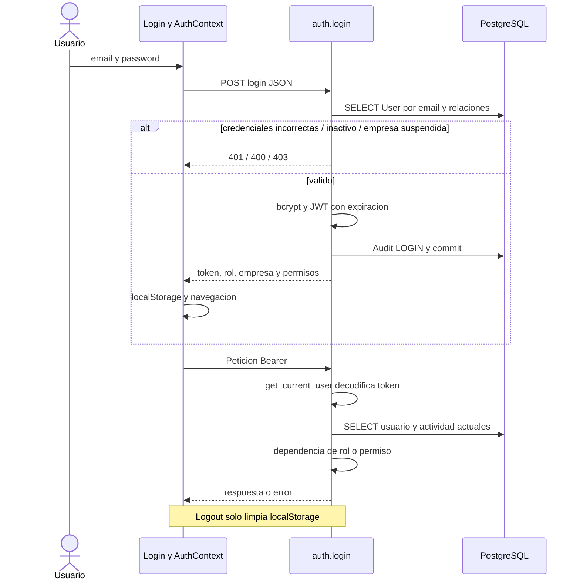
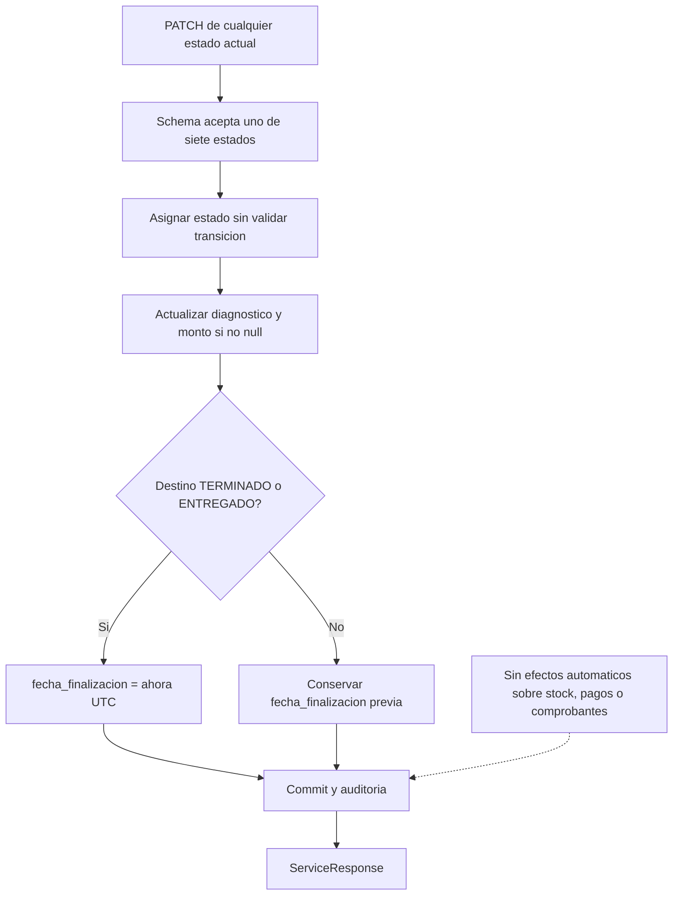
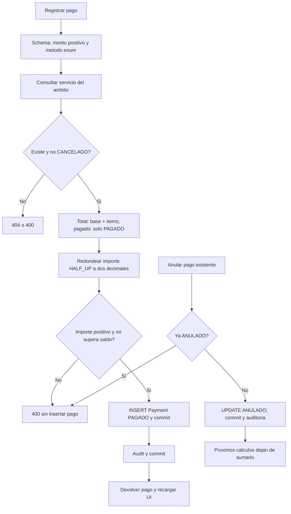
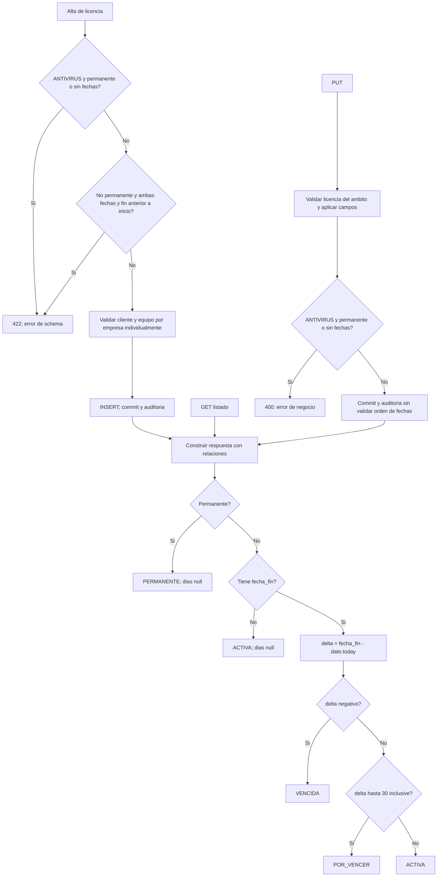
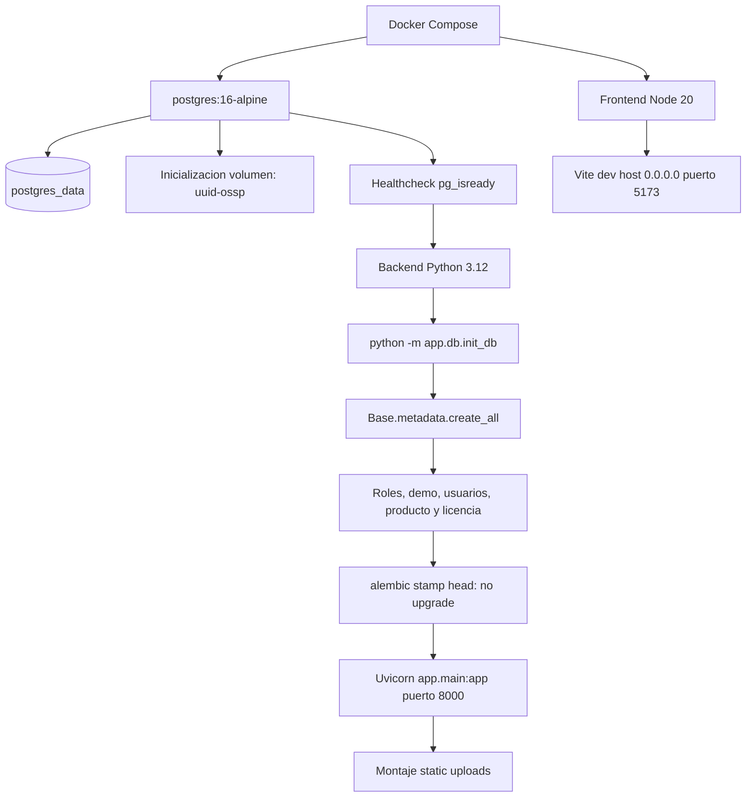

# Flujos de ejecución

Los diagramas representan el código actual, incluidas sus asimetrías. No son un diseño propuesto ni constancia de ejecución. Los recorridos secundarios (alta/suspensión de empresa, usuarios, clientes, equipos, notificación y auditoría) se reconstruyen paso a paso en las fichas F02–F05 y F15 de [catálogo](03-catalogo-funcionalidades.md).

## Inicio de sesión y autorización

Login inicia el flujo; falla por identidad/actividad o termina en JWT persistido localmente. La autorización de cada petición vuelve a consultar User. `backend/app/api/routes/auth.py:13-56`; `backend/app/api/deps.py:12-74`; `frontend/src/context/AuthContext.jsx:25-73`.



[Fuente Mermaid](diagramas/autenticacion.mmd).

## Alta de orden con equipo opcional

Inicia guardar formulario; el alta rápida es una transacción previa independiente. Valida pertenencia, escribe orden y eventualmente URL del equipo; termina con recarga. `frontend/src/pages/Services.jsx:162-244,366-435`; `backend/app/api/routes/services.py:60-125`.

```mermaid
sequenceDiagram
  actor U as Operador
  participant UI as Services.jsx
  participant LIST as Routers de consulta
  participant EQ as equipment.create_equipment
  participant API as services.create_service
  participant DB as PostgreSQL
  UI->>LIST: GET services, clients, equipment
  LIST->>DB: Consultas filtradas por empresa
  LIST-->>UI: Listados
  opt ADMIN
    UI->>LIST: GET users
    LIST->>DB: Consultar usuarios
    LIST-->>UI: Usuarios
  end
  opt Alta rapida de equipo
    U->>UI: Datos de equipo
    UI->>EQ: POST equipment
    EQ->>DB: Validar cliente; INSERT; commit; Audit
    EQ-->>UI: Equipo ya persistido
  end
  U->>UI: Guardar orden
  UI->>API: POST ServiceCreate
  API->>DB: Buscar cliente del ambito
  opt equipo_id no null
    API->>DB: Buscar equipo del cliente y ambito
    API->>DB: Actualizar imagen si enviada
  end
  alt cliente o equipo invalido
    API-->>UI: 404 o 400
  else valido
    API->>DB: INSERT Service RECIBIDO y commit
    API->>DB: Audit y segundo commit
    API-->>UI: ServiceResponse con items
    UI->>UI: Recargar y cerrar modal
  end
```

[Fuente Mermaid](diagramas/orden-servicio.mmd).

## Cambio de estado y diagnóstico

Inicia guardar estado; enum limita valores, no recorridos. Finalización se sobrescribe en dos destinos y no se limpia en los otros. `backend/app/api/routes/services.py:127-173`; `frontend/src/pages/ServiceDetail.jsx:261-301`.



[Fuente Mermaid](diagramas/estados-servicio.mmd).

## Consumo de inventario

Inicia agregar producto; bloquea fila, escribe stock/item/movimiento y audit en la sesión; termina con JSON y dos consultas UI. `backend/app/api/routes/services.py:175-272`; `backend/app/services/audit_service.py:5-23`.

```mermaid
sequenceDiagram
  actor U as Operador
  participant UI as ServiceDetail
  participant API as add_product_to_service
  participant AUD as log_audit
  participant DB as PostgreSQL
  U->>UI: Producto y cantidad
  UI->>API: POST services/id/products
  API->>API: Exigir cantidad positiva
  API->>DB: SELECT Service del ambito
  API->>DB: SELECT Product activo FOR UPDATE
  alt ausente o stock insuficiente
    API-->>UI: 404 o 400
  else disponible
    API->>API: stock -= cantidad; subtotal = precio * cantidad
    API->>DB: Preparar SALIDA y ServiceItem
    API->>AUD: Auditar SALIDA_INVENTARIO
    AUD->>DB: INSERT Audit y COMMIT de toda la sesion
    API->>DB: commit adicional y refresh
    API-->>UI: service_item y stock_actual
    UI->>UI: Recargar servicio y productos
  end
  Note over UI,API: Restriccion de orden cerrada solo en UI
```

[Fuente Mermaid](diagramas/consumo-productos.mmd).

## Cobro y anulación

Inicia registro o anulación; recalcula saldo con pagos válidos; no cambia estado técnico ni comprobante. `backend/app/api/routes/payments.py:21-236`; `frontend/src/pages/Payments.jsx:416-500`.



[Fuente Mermaid](diagramas/pagos.mmd).

## Emisión, PDF y anulación

Inicia emitir desde detalle; toma snapshot de cliente/importes. PDF consulta sin filtro de empresa y anular no elimina snapshot. `backend/app/api/routes/invoices.py:147-371,844-945,1477-1494`; `frontend/src/pages/Invoices.jsx:347-421`.

```mermaid
sequenceDiagram
  actor U as Administrador en UI
  participant UI as ServiceDetail / Invoices
  participant API as invoices router
  participant DB as PostgreSQL
  U->>UI: Emitir tipo, serie y observaciones
  UI->>API: POST invoices
  API->>DB: SELECT orden, items, cliente y comprobante previo
  alt cancelado / duplicado / inexistente
    API-->>UI: 400 / 404
  else valido
    API->>API: Calcular base + items y snapshot cliente
    API->>DB: SELECT mayor numero por empresa, tipo y serie
    API->>DB: INSERT Invoice, flush y detalles
    API->>DB: log_audit confirma sesion
    API-->>UI: InvoiceResponse
  end
  U->>UI: Descargar PDF
  UI->>API: GET invoices/id/pdf con Bearer
  API->>DB: SELECT por ID, sin filtro de empresa
  API->>API: Construir PDF ReportLab en BytesIO
  API-->>UI: application/pdf attachment
  UI->>UI: Blob, enlace download y revokeObjectURL
  opt Anular
    UI->>API: PATCH invoices/id/anular
    API->>DB: Filtrar empresa; cambiar estado; auditar y commit
  end
```

[Fuente Mermaid](diagramas/comprobantes.mmd).

## Captura móvil y sincronización por polling

Inicia crear sesión desde modal; enlace otorga acceso de captura; almacenamiento y guardar formulario son pasos independientes. `backend/app/api/routes/uploads.py:52-118`; `frontend/src/components/ImageUploadControl.jsx:55-103`; `frontend/src/pages/MobileCameraUpload.jsx:35-58`.

```mermaid
sequenceDiagram
  participant PC as Formulario PC
  participant API as uploads
  participant QR as qrserver.com
  participant MOV as Navegador movil
  participant FS as Disco
  PC->>API: POST session/create sin login requerido
  API->>API: Guardar UUID PENDING en diccionario
  API-->>PC: session_id y fecha
  PC->>QR: GET imagen con URL completa de captura
  QR-->>PC: Imagen QR
  MOV->>MOV: Abrir captura-movil/ID, seleccionar imagen
  MOV->>API: POST session/ID/upload multipart
  API->>API: Comprobar sesion y MIME declarado
  API->>FS: Escribir foto completa
  API->>API: Marcar COMPLETED y photo_url
  API-->>MOV: COMPLETED
  loop Cada 1500 ms mientras PENDING y modal abierto
    PC->>API: GET session/ID
    API-->>PC: Estado y URL
  end
  PC->>PC: onChange URL y cerrar modal
  Note over PC,API: Persistir URL en entidad requiere guardar formulario
  Note over API,FS: Reinicio pierde sesiones; no elimina fotos
```

[Fuente Mermaid](diagramas/captura-qr.mmd).

## Alta, actualización y cálculo de vigencia

Inicia alta/edición/listado. En el bloque de alta, cada rechazo termina con error, sin INSERT; el gráfico continúa únicamente si pasa la validación. PUT tiene controles menores que POST. `backend/app/schemas/license.py:18-45`; `backend/app/api/routes/licenses.py:16-180`.



[Fuente Mermaid](diagramas/licencias.mmd).

## Arranque declarado en contenedores

Inicia docker compose up; dependencia healthy en PostgreSQL, inicialización y stamp antes de API; frontend tiene depends_on sin healthcheck de API. Se documenta, no se ejecutó. `docker-compose.yml:2-60`; `backend/Dockerfile:21`; `backend/app/db/init_db.py:9-174`.



[Fuente Mermaid](diagramas/arranque.mmd).

